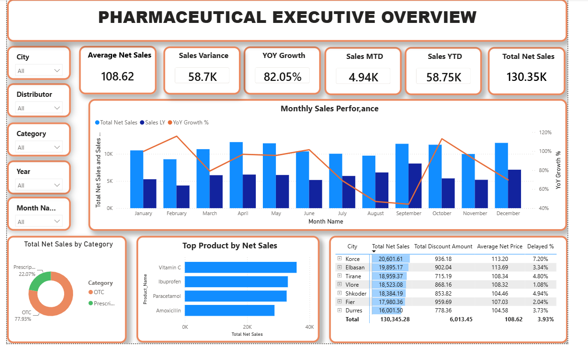

# 💊 Pharmaceutical Sales & Executive Analytics Dashboard

An interactive multi-page Power BI dashboard designed for executive reporting in the pharmaceutical sector. This project analyzes revenue performance, product & molecule metrics, distributor channels, and regional sales distribution.

---

## 📊 Dashboard Preview

### 1. Executive Overview

### 2. Sales & Product Performance

### 3. Geographic & Distribution Analysis

### 4. Financial & Operational Performance

---

## 🔑 Key Business Objectives & Insights

- **Executive KPI Monitoring:** Monitored total revenue, gross profit, order volume, and discount rates across pharmaceutical product lines.
- **Product & Molecule Matrix:** Analyzed sales dynamics by active molecules, product categories, and top-performing SKUs.
- **Distributor Dynamics:** Evaluated distributor performance to optimize commercial agreements and regional coverage.
- **Regional Analytics:** Identified top-performing cities and territories across the commercial territory.

---

## 🛠️ Technical Stack & Implementation

- **Business Intelligence Tool:** Microsoft Power BI
- **Data Transformation:** Power Query (M Code) for data cleansing and attribute mapping.
- **Data Modeling:** Star Schema architecture connecting Sales Fact tables with Product, Geography, and Distributor Dimensions.
- **Advanced DAX Measures:**
  - Sales & Profit Aggregations (`Total Revenue`, `Gross Margin %`, `Average Discount %`).
  - Time Intelligence comparisons (`Sales YTD`, `Sales PY`, `YoY Growth %`).

---

## 👤 Author
- **GitHub:** [@Ralfi2208](https://github.com/Ralfi2208)
